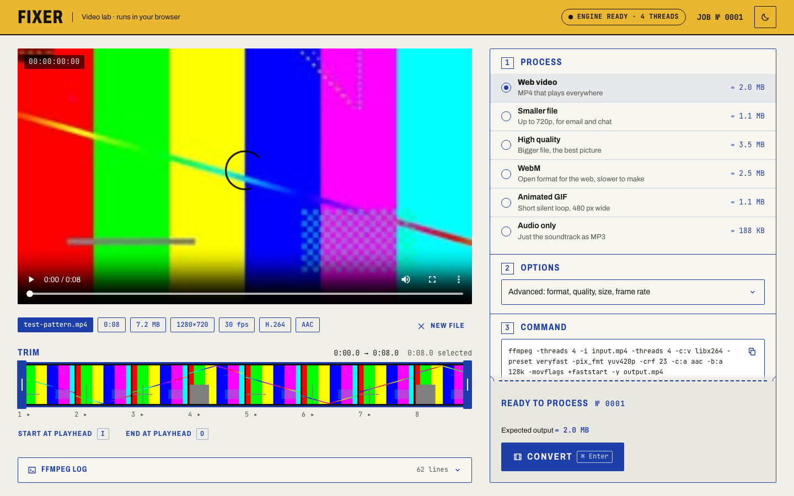
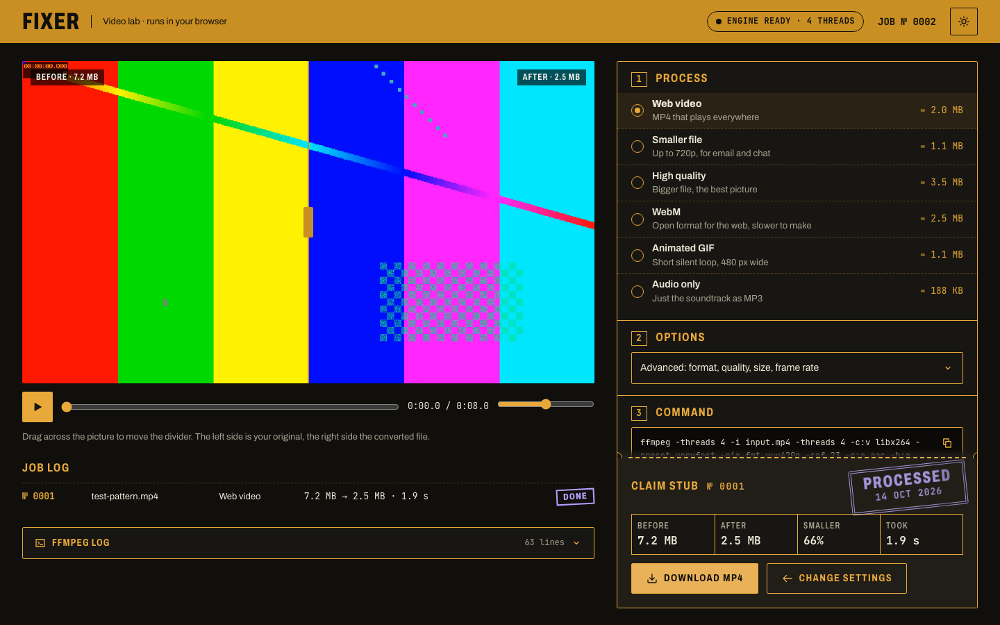

# Fixer

Convert, shrink, trim and turn videos into GIFs without uploading them anywhere. Fixer runs ffmpeg in the browser through [ffmpeg.wasm](https://ffmpegwasm.netlify.app/), so the file never leaves your machine.



## What it does

- Drop, pick or paste a video, or make a test clip with ffmpeg's own `testsrc2`
- Preview with a filmstrip and trim handles (`I` / `O` set in and out at the playhead)
- Presets for people who don't care about codecs: web MP4, smaller file, high quality, WebM, animated GIF and MP3
- Advanced options for people who do: container, codec, CRF or target bitrate, max height, frame rate, audio
- Shows the exact `ffmpeg` command for the current settings, ready to copy
- Live progress, time left, encode speed and output size, read straight from ffmpeg's log
- Before/after comparison with a draggable divider, plus a job log that keeps cancelled and failed runs
- Light and dark themes



## Running it

```sh
pnpm install
pnpm dev
```

```sh
pnpm build
pnpm preview
```

## How it works

The interesting part is small:

- `src/lib/buildArgs.ts` turns settings into ffmpeg arguments
- `src/composables/useFFmpeg.ts` loads the engine, queues commands and streams the log
- `src/lib/parseLog.ts` reads duration, streams, progress and speed out of that log
- `src/composables/useConverter.ts` ties it together: probing, thumbnails, conversion, cancel

### Cross-origin isolation

The multithreaded build of ffmpeg.wasm needs `SharedArrayBuffer`, which browsers only expose on cross-origin isolated pages. Every response has to include:

```
Cross-Origin-Embedder-Policy: require-corp
Cross-Origin-Opener-Policy: same-origin
```

The Vite dev and preview servers set these in `vite.config.ts`. For hosting, `public/_headers` covers Cloudflare and Netlify, and `vercel.json` covers Vercel. Without the headers the app falls back to the single-threaded core and says so.

### Things I ran into

- **Where the core lives.** The ffmpeg core is about 31 MB of wasm, which is over the 25 MiB per-file limit on Cloudflare Workers, and Vite's dev server rewrites imports in anything it serves, which breaks ffmpeg's pthread worker. So the core is loaded from jsDelivr through `toBlobURL`, pinned to the version of `@ffmpeg/core-mt` in `pnpm-lock.yaml`. jsDelivr sends `Access-Control-Allow-Origin: *`, which satisfies `require-corp`.
- **Thread limits.** The multithreaded core has a fixed pool of 32 pthreads. Letting ffmpeg pick its own thread count (or using more than about 4) deadlocks when decoding and encoding audio and video at the same time. Every command gets an explicit `-threads`.
- **Two inputs deadlock** in the same way, so the test clip comes from a single `lavfi` graph with two outputs instead of two `-f lavfi` inputs.
- **VP9 crashes** the multithreaded core with an out-of-bounds memory error, so WebM uses VP8 + Opus. If ffmpeg crashes anyway, the engine restarts and the job is marked as failed.

## Stack

Vue 3, Vite and TypeScript. No UI library. Archivo and JetBrains Mono are self-hosted via Fontsource, since `require-corp` blocks third-party fonts that don't opt in.

---

Built by [Fredrik Tidemann](https://tidemann.dev)
